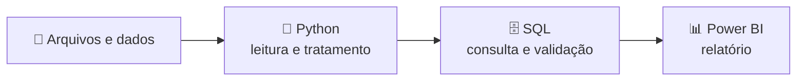

<!--
COMO USAR (apague este bloco na versão pública)
1. No repositório público github.com/eliasdevmind/eliasdevmind (já pode existir: edite o README atual), crie a pasta "assets" e envie
   header.svg e header.png (arquivos em github-perfil\assets\). Depois cole este README.md.
2. Os cartões de estatística vêm de serviços externos (github-readme-stats, streak-stats). Mostram dados REAIS do seu GitHub, mas
   podem ficar fora do ar às vezes. Se algum não carregar, apague aquele bloco.
3. Antes de publicar, confirme com o Mestre o que é experiência de trabalho e o que é conhecimento/estudo, e preencha os projetos com dados reais.
4. Contato: só LinkedIn/portfólio/Instagram (sem e-mail nem telefone).
-->

 

---

## 👨‍💻 Sobre mim

Desenvolvedor **Full Stack com foco em automação e dados**. Comecei pela programação e hoje trabalho bastante com automação, usando **Python, SQL e Power BI**, além de **PHP, Angular e Golang** no desenvolvimento de aplicações.
Gosto de entender como uma rotina funciona, identificar o que pode ser automatizado e construir soluções práticas.

📍 São Luís – MA, Brasil

## 🎯 O que eu faço

| ⚙️ Automação | 📊 Dados | 🧩 Desenvolvimento |
|---|---|---|
| Transformo rotinas manuais em processos automatizados | Consulto, trato e apresento dados com **SQL** e **Power BI** | Aplicações web e APIs com **PHP, Angular e Golang** |

## 🔄 Do dado ao relatório

## 🧰 Tecnologias

## 🚀 Projetos em destaque

<!-- Quando o projeto de automação e dados de ponta a ponta estiver pronto, adicione aqui um cartão e uma frase: problema, minha contribuição, como executar. -->

## 📈 GitHub em números

## 📝 O que compartilho

Projetos, decisões técnicas e aprendizados sobre programação, automação e dados: do problema inicial à demonstração do que foi construído, incluindo erros e limitações.

## 🤝 Vamos conversar?

Se o assunto é automação, dados ou desenvolvimento, me chame no [LinkedIn](https://www.linkedin.com/in/eliasdevmind) ou veja meus projetos no [portfólio](https://eliasdevmind.vercel.app/).

