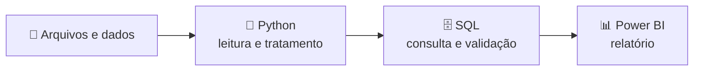

 

---

## 👨‍💻 Sobre mim

Desenvolvedor **Full Stack com foco em automação e dados**. Comecei em TI com manutenção de computadores e hoje trabalho bastante com automação, usando **Python, SQL e Power BI**, além de **PHP, Angular e Golang** no desenvolvimento de aplicações.
Gosto de entender como uma rotina funciona, identificar o que pode ser automatizado e construir soluções práticas.

📍 São Luís – MA, Brasil

## 🎯 O que eu faço

| ⚙️ Automação | 📊 Dados | 🧩 Desenvolvimento |
|---|---|---|
| Transformo rotinas manuais em processos automatizados | Consulto, trato e apresento dados com **SQL** e **Power BI** | Aplicações web e APIs com **PHP, Angular e Golang** |

## 🔄 Do dado ao relatório

## 🧰 Tecnologias

## 🚀 Projetos em destaque

| Projeto | O que é | Tecnologias |
|---|---|---|
| [**leitor-de-rem-e-ret**](https://github.com/eliasdevmind/leitor-de-rem-e-ret) | Automação que lê arquivos `.REM` e `.RET`, gera arquivos de saída e uma análise | Python |
| [**planilha-csv**](https://github.com/eliasdevmind/planilha-csv) | Converte CSV em Excel formatado, configurável por `config.json` (com manual) | Python |
| [**e-comerce**](https://github.com/eliasdevmind/e-comerce) | E-commerce de jogos: carrinho, pedidos, pagamento com Mercado Pago, painel administrativo e analytics | JavaScript, back-end + banco de dados |
| [**imersaoIA**](https://github.com/eliasdevmind/imersaoIA) | Chatbot em Flask que usa a API Gemini para tirar dúvidas sobre jogos | Python, Flask |
| [**projetoApiDeImages**](https://github.com/eliasdevmind/projetoApiDeImages) | API REST (Flask-RESTx) que devolve imagens por categoria | Python, Flask |

Veja todos os repositórios em [github.com/eliasdevmind?tab=repositories](https://github.com/eliasdevmind?tab=repositories).

## 📝 O que compartilho

Projetos, decisões técnicas e aprendizados sobre programação, automação e dados: do problema inicial à demonstração do que foi construído, incluindo erros e limitações.

## 🤝 Vamos conversar?

Se o assunto é automação, dados ou desenvolvimento, me chame no [LinkedIn](https://www.linkedin.com/in/eliasdevmind) ou veja meus projetos no [portfólio](https://eliasdevmind.vercel.app/).

